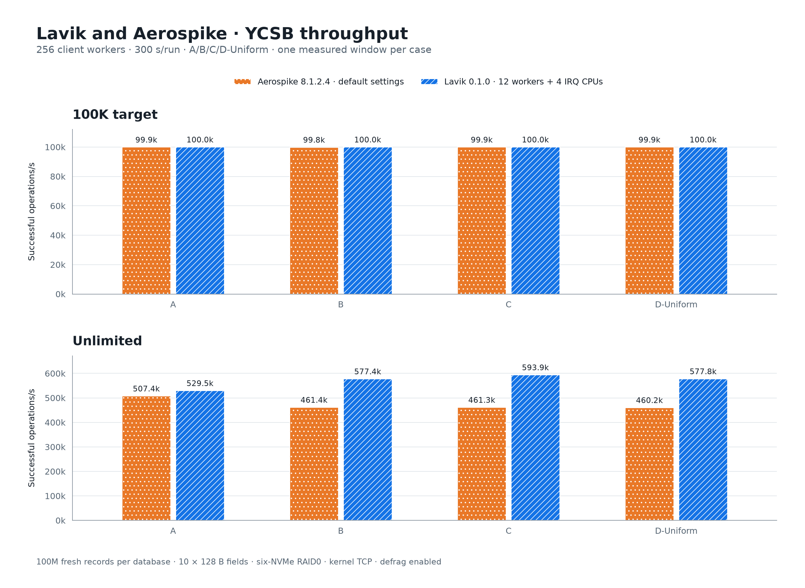
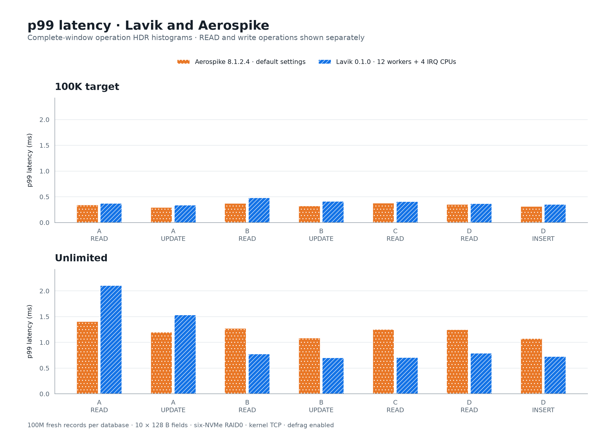
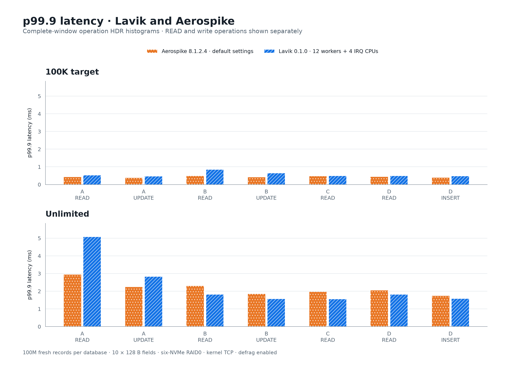
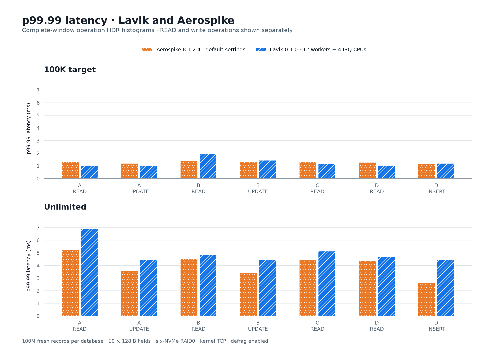

# Lavik v0.1.0 与 Aerospike：YCSB 吞吐及尾延迟

[English](README.md) | **简体中文**

两库独立新灌 **1 亿条记录，每条 10 × 128 B 字段**。完整 **A/B/C/D × 100K/不限速** 矩阵包含 16 个正式测量窗口，每个 300 秒；所有预热与正式阶段错误为零。**Lavik defrag 全程开启**。

Aerospike 使用默认性能配置及原始宿主策略；Lavik 使用 12 workers 加 4 核系统/IRQ 隔离，io_uring 接入 RAID0 裸分区。两者 CPU 分配与数据库配置不同。

## 吞吐与尾延迟



不限速总吞吐相对 Aerospike 的实测差异：A **+4.36%**, B **+25.13%**, C **+28.76%**, D **+25.56%**.

表格单元格为 **操作 QPS；p99 / p99.9 / p99.99（ms）**。读写分位数分别展示；接近限速目标不表示尾延迟更低。

| Workload | 限速 | 操作 | Aerospike（默认参数、原始宿主配置） | Lavik（100ms、12+4 隔离） |
|---|---|---|---:|---:|
| A | 不限速 | 总 QPS | 507,401 | 529,501 |
| A | 不限速 | READ | 253,704；1.407 / 2.953 / 5.219 | 264,758；2.105 / 5.083 / 6.883 |
| A | 不限速 | UPDATE | 253,697；1.196 / 2.255 / 3.561 | 264,743；1.532 / 2.831 / 4.435 |
| A | 100K | 总 QPS | 99,883 | 99,966 |
| A | 100K | READ | 49,932；0.342 / 0.437 / 1.317 | 49,987；0.372 / 0.530 / 1.046 |
| A | 100K | UPDATE | 49,951；0.292 / 0.385 / 1.208 | 49,979；0.337 / 0.474 / 1.046 |
| B | 不限速 | 总 QPS | 461,404 | 577,373 |
| B | 不限速 | READ | 438,351；1.274 / 2.313 / 4.539 | 548,492；0.776 / 1.818 / 4.835 |
| B | 不限速 | UPDATE | 23,053；1.087 / 1.853 / 3.389 | 28,881；0.702 / 1.578 / 4.467 |
| B | 100K | 总 QPS | 99,827 | 99,967 |
| B | 100K | READ | 94,829；0.374 / 0.498 / 1.417 | 94,968；0.482 / 0.856 / 1.920 |
| B | 100K | UPDATE | 4,998；0.321 / 0.426 / 1.348 | 4,999；0.410 / 0.653 / 1.436 |
| C | 不限速 | READ | 461,251；1.253 / 1.982 / 4.431 | 593,911；0.707 / 1.556 / 5.119 |
| C | 100K | READ | 99,902；0.379 / 0.481 / 1.322 | 99,970；0.406 / 0.495 / 1.173 |
| D | 不限速 | 总 QPS | 460,167 | 577,808 |
| D | 不限速 | READ | 437,177；1.246 / 2.055 / 4.379 | 548,915；0.790 / 1.824 / 4.683 |
| D | 不限速 | INSERT | 22,991；1.077 / 1.754 / 2.611 | 28,893；0.724 / 1.589 / 4.443 |
| D | 100K | 总 QPS | 99,901 | 99,961 |
| D | 100K | READ | 94,906；0.351 / 0.442 / 1.275 | 94,962；0.368 / 0.488 / 1.035 |
| D | 100K | INSERT | 4,995；0.311 / 0.404 / 1.186 | 4,999；0.354 / 0.479 / 1.205 |







## 硬件与存储

| 项目 | 配置 |
|---|---|
| 服务端 | Azure Standard_L16aos_v4，Japan West / zone 2；AMD EPYC 9V74；16 逻辑核 / 8 物理核；Linux 内存 125.8 GiB |
| 客户端 | Azure Standard_F32als_v6；AMD EPYC 9V74；32 物理核、62.8 GiB 内存；Java 17；YCSB 进程限制到 CPU 0–15 |
| 系统 | 两端均为 Ubuntu 24.04、Linux 6.17.0-1022-azure；未重启 |
| 网络 | 单客户端 10.84.0.5 → 服务端 10.84.1.4；kernel TCP、mlx5 加速路径 |
| 物理盘 | 六张本地 NVMe，每张 1,919,850,381,312 B；Linux RAID0，chunk=512 KiB |
| 分区 | 两个独立裸分区，各 1,099,494,850,560 B；24 MiB 对齐；无文件系统；灌入前全量写零 |
| 监测 | 每 phase 的有效配置、进程、IRQ、存储、客户端计数；开启 Lavik metrics |

## 数据与工作负载

| Workload | READ | UPDATE | INSERT | 读取分布 |
|---|---:|---:|---:|---|
| A | 50% | 50% | 0 | 均匀随机 |
| B | 95% | 5% | 0 | 均匀随机 |
| C | 100% | 0 | 0 | 均匀随机 |
| D-Uniform | 95% | 0 | 5% | 固定初始 1 亿条 key |

| 记录数 | Aerospike | Lavik |
|---|---:|---:|
| 起始 | 100,000,000 | 100,000,000 |
| 完成矩阵后 | 108,497,069 | 110,271,711 |

## 数据库与宿主配置

| 设置 | Aerospike | Lavik |
|---|---|---|
| 版本 | Community Edition 8.1.2.4-4 | v0.1.0 标准 x86_64 正式包 |
| 存储 | storage-engine device，RAID0 裸分区 | --storage=uring，RAID0 裸分区 |
| CPU | 原始宿主策略，CPU 0–15；默认 service-threads=80、auto-pin=none | CPU 0–11 上 12 个固定 worker；系统任务、workqueue、NIC IRQ 使用 CPU 12–15 |
| systemd | 默认 system.slice，不额外限制 affinity | lavik-bench.slice，AllowedCPUs/CPUAffinity=0–11 |
| Flush | 默认 1 MiB、1000 ms | 128 KiB 写块，100 ms |
| 缓存 | 默认 max-write-cache=64 MiB、post-write-cache=256 MiB、read-page-cache=false | 正式包默认值 |
| 索引预算 | 默认 indexes-memory-budget=0 | 正式包默认值 |
| GC / defrag | 默认值 | 开启；每设备最多 8 任务；block/record sleep=0 |
| READ | 全部 10 个 bin | HGETALL，全部 10 个字段 |
| UPDATE | REPLACE_ONLY，全部 10 个 bin | LAVIK.HREPLACE，全部 10 个字段 |
| INSERT | CREATE_ONLY | HMSET，redis.scanindex=none |
| 客户端 binding | YCSB Aerospike，Java client 3.1.2 | YCSB Redis，Jedis 3.9.0 |
| 复制 / TTL | 单节点 RF=1、namespace ycsb；默认 TTL 0 | 单实例 DB0、无副本、无 TTL |

Lavik 为未改动的标准正式包：`v0.1.0 / feb61224e414c5653fd09560e20c9d214db1e3ac`; SHA-256 `7bf8d204a137678cee0e1a621b02661181373fbbfe1366bc1c201942b9dcf420`. Aerospike SHA-256 `6e1b2bd6deebd5816f4f369ac1db4151217ed0be3b66578bdd6f15c24e6af8d0`.

## 测量方法与边界

- 沿用 [9 月 YCSB 报告](../ycsb-rerun-2026-09-13/README.zh-CN.md)：两库独立新灌 1 亿条记录，按 C/A/B/D 顺序，每个 workload 先限速 100K 再不限速；先 Aerospike 后 Lavik。同一 RAID0 顺序使用，数据库不同时运行。正式矩阵各 case 之间不清库、不重启。
- 每个 case 使用 256 个 YCSB worker，单独 JVM 预热 100 万次操作，再用新的 JVM 正式测量 300 秒。`-target 100000` 是所有线程、所有操作合计限速；正式 `operationcount=2000000000` 仅作宽松上限，以计时器结束。JIT/启动爬坡没有从测量窗口剔除。
- 10 个字段，每字段固定 128 B；readallfields/writeallfields=true；hashed key、uniform 读取；SCAN 与 read-modify-write 关闭；客户端超时 10,000 ms。字段值原始载荷共 128 GB（119.21 GiB），不含 key、字段名、索引和记录格式开销。
- D 只读取最初的 1 亿条 key，因此标为 D-Uniform。100K 预热/测量 INSERT 起点为 2B/4B；不限速为 6B/8B，互不重叠。两库起始规模相同；最终记录数随 D 的成功插入吞吐而不同。
- 两库均核验恰好 1 亿次成功 INSERT 与服务端记录数一致；灌入后干净停止并恢复。对八个分布式样本核验全部十个字段长度及 SHA-256，比较恢复前后的一致性。每个 phase 核对客户端成功数、服务端命令计数和记录数增量，错误必须为零。
- Aerospike 仅配置必需的集群/监听/namespace/RF/设备选项；CPU 调度、IRQ、线程、缓存、flush、索引预算和回收保留默认值，每阶段前后记录有效配置。Aerospike 停止后才应用 Lavik 的 12+4 CPU/IRQ 隔离，结束后恢复宿主策略。核验 completion IRQ 的实际 CPU 及中断增量，确认它们在测试阶段不落到 Lavik worker 核。
- Lavik 在灌入、恢复、预热和测量全程开启 defrag，每设备最多 8 个任务，不加额外 sleep。每阶段记录 CONFIG GET defrag-paused 与 DEFRAG STATUS。本 YCSB 组的 Tomb Raider、active expiration 保留正式包默认值。100 ms 周期 flush 不代表逐写同步持久化承诺。
- CPU 编号为逻辑核：worker 0–11 占六个物理核，系统/IRQ 12–15 占另外两个物理核（SMT2）。源地址策略路由将 10.84.1.4 的回复经 eth1/table 101 发出，压测回复不走管理网卡。
- QPS=成功操作数/实际 YCSB RunTime；总 QPS 包含成功读写。各操作 p99/p99.9/p99.99 取完整窗口 ordinary HDR histogram，不平均区间分位数；intended histogram 保存在原始日志中。相同 worker 数不意味着相同 TCP 连接数。
- 全部是新测量，没有复用旧结果。客户端型号/CPU 与 9 月报告不同，压测进程限制到 16 CPU；Lavik 改用标准 GCC/x86-64-v2 正式包，而非旧 native 构建。裸分区容量/对齐相同，但位置重新建立。这些变化意味着不能把历史报告间的差异仅归因于代码。
- 正式灌入前有三次环境准备失败：缺少 Aerospike 运行目录、缺少 python 启动别名、监听端口就绪早于分区归属就绪。原始日志保存在 evidence/setup-failure-*；补齐运行环境后，就绪检查等待全部 4096 个主分区。没有更换 Java binding 或修改数据库性能参数；失败尝试未插入记录，也不计入测量窗口。
- 自定义 YCSB 源码为 `eloqdata/YCSB@a47bf01c4f197d2ff2eecbbebd9743da5a1cae47`，叠加留档的 LAVIK.HREPLACE 命令名补丁；实际 binding 源码和 JAR 哈希均留档。
- 每个 cell 只有一次 5 分钟测量，未估计运行间波动或置信区间，产品顺序固定。两种指定部署的 CPU 分配、宿主策略、缓存、持久化保证不同，不是单变量实验。

| Database | Measured window (UTC) | Cases |
|---|---|---:|
| Aerospike | 2026-10-13T09:54:41Z – 2026-10-13T10:35:42Z | 8 |
| Lavik | 2026-10-13T10:39:09Z – 2026-10-13T11:20:04Z | 8 |

完成后已恢复原始 CPU/IRQ 策略，Lavik 干净停止，Aerospike 完成最终恢复与数据核验；记录数描述 YCSB 矩阵结束时的状态。

## 证据与复现

[结果 JSON](results.json) · [操作 CSV](summary.csv) · [二进制身份](binaries.json) · [服务端清单](server-inventory.json) · [客户端清单](client-inventory.json) · [网络路径](network-path.json) · [YCSB 源码](evidence/client-source/source.json) · [客户端 JAR 哈希](evidence/client-jars.sha256) · [全部阶段](evidence/phases.json) · [采集脚本](evidence/runner.py) · [宿主策略](evidence/host_policy.py) · [客户端命令](evidence/ycsb_client.py) · [Aerospike 配置](evidence/aerospike.conf) · [存储清单](evidence/storage-after.json) · [完成状态](evidence/complete.json) · [校验和](SHA256SUMS)

```sh
python3 perf_reports/lavik-v0.1.0-aerospike-ycsb-2026-10-13/verify_report.py
python3 perf_reports/lavik-v0.1.0-aerospike-ycsb-2026-10-13/build_assets.py
```

离线校验需要 Python 3.11+；绘图需要 Matplotlib 3.11.2。校验覆盖两次全新灌入、32 个阶段、16 个正式窗口、28 行操作结果、每阶段宿主/数据库策略、中英文表格和证据文件哈希；不会启动数据库或打开裸设备。在线重跑需要新的临时数据空间和未使用的 D 插入区间。不包含私钥、下载的可执行文件或生成的数据库。
