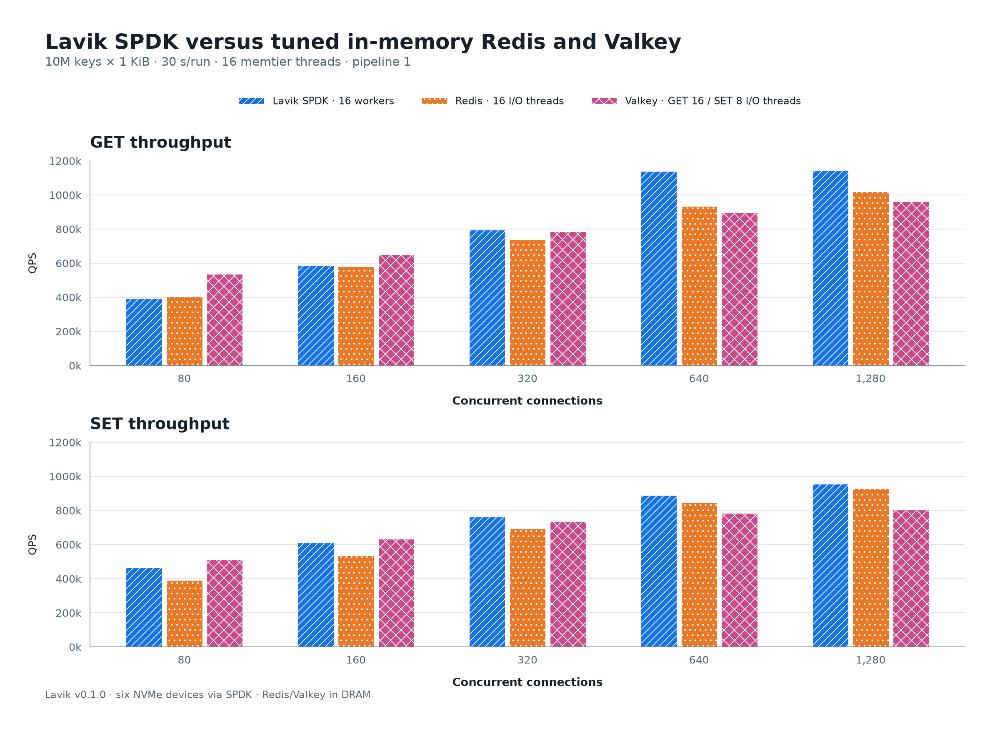
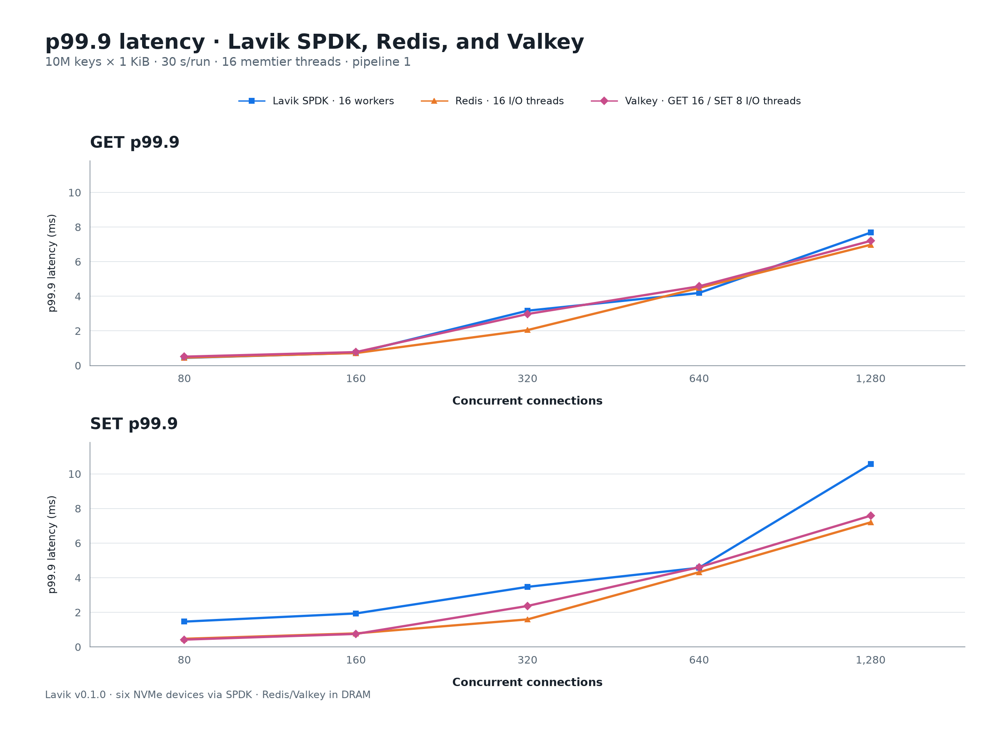
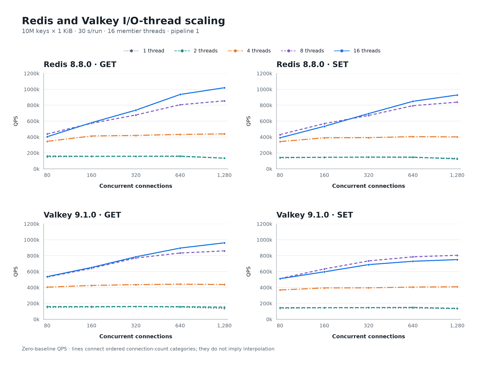

# Lavik v0.1.0: GET/SET versus Redis and Valkey

**English** | [简体中文](README.zh-CN.md)

Test date: 2026-10-13. The downloaded **Lavik v0.1.0 standard x86_64 release** was tested against freshly measured Redis 8.8.0 and Valkey 9.1.0 controls. All **110 formal points** use 10 million keys with 1,024-byte values. Lavik defrag stayed enabled throughout loading, warmup and measurement. No historical control results are reused.

Lavik's peak GET was **1140.5k QPS** at 1280 connections (p99.9 **7.679 ms**); peak SET was **955.4k QPS** at 1280 connections (p99.9 **10.559 ms**). These are single-run observations. At the peak points in the table, Lavik has higher throughput and higher p99.9 latency than both peers for GET and SET; the full curves show how this changes with concurrency.

## 10M keys × 1 KiB: throughput and latency



| Command | System | Threads¹ | Connections | QPS | Avg ms | p50 ms | p99 ms | p99.9 ms | p99.99 ms |
|---|---|---:|---:|---:|---:|---:|---:|---:|---:|
| GET | Lavik 0.1.0 SPDK | 16 | 1280 | 1,140,483 | 1.122 | 1.039 | 3.967 | 7.679 | 31.487 |
| GET | Redis 8.8.0 | 16 | 1280 | 1,019,880 | 1.254 | 1.095 | 4.415 | 6.975 | 13.631 |
| GET | Valkey 9.1.0 | 16 | 1280 | 961,722 | 1.330 | 1.119 | 4.383 | 7.199 | 14.847 |
| SET | Lavik 0.1.0 SPDK | 16 | 1280 | 955,414 | 1.339 | 1.119 | 4.543 | 10.559 | 43.775 |
| SET | Redis 8.8.0 | 16 | 1280 | 928,242 | 1.379 | 1.159 | 4.479 | 7.199 | 15.487 |
| SET | Valkey 9.1.0 | 8 | 1280 | 804,951 | 1.590 | 1.455 | 4.095 | 7.583 | 15.295 |



For each Redis/Valkey command, select one I/O-thread configuration by its measured peak and show its complete connection sweep. The latency plot uses the same selection. The table gives each product’s measured peak point. ¹ Lavik counts data workers; Redis/Valkey count I/O threads.

## I/O-thread sweep



| System | I/O threads | Peak GET QPS @ connections | Peak SET QPS @ connections |
|---|---:|---:|---:|
| Redis 8.8.0 | 1 | 157,073 @ 320 | 146,331 @ 320 |
| Redis 8.8.0 | 2 | 159,837 @ 640 | 147,882 @ 320 |
| Redis 8.8.0 | 4 | 439,070 @ 1280 | 404,721 @ 640 |
| Redis 8.8.0 | 8 | 854,878 @ 1280 | 838,300 @ 1280 |
| Redis 8.8.0 | 16 | 1,019,880 @ 1280 | 928,242 @ 1280 |
| Valkey 9.1.0 | 1 | 158,131 @ 320 | 145,078 @ 160 |
| Valkey 9.1.0 | 2 | 160,905 @ 320 | 149,623 @ 640 |
| Valkey 9.1.0 | 4 | 441,615 @ 640 | 408,896 @ 1280 |
| Valkey 9.1.0 | 8 | 860,629 @ 1280 | 804,951 @ 1280 |
| Valkey 9.1.0 | 16 | 961,722 @ 1280 | 750,593 @ 1280 |

## Hardware and deployment

| Item | Configuration |
|---|---|
| Server | Azure Standard_L16aos_v4, Japan West zone 2; AMD EPYC 9V74; 16 logical CPUs / 8 physical cores; 125.8 GiB Linux RAM |
| Client | Azure Standard_F32als_v6; AMD EPYC 9V74; 32 physical cores; 62.8 GiB Linux RAM; benchmark process restricted to CPUs 0–15 |
| OS | Ubuntu 24.04; Linux 6.17.0-1022-azure on both hosts; no reboot during this batch |
| Network | Client 10.84.0.5 → server 10.84.1.4:6379, accelerated mlx5 path, kernel TCP |
| Server CPUs | 0–15 for all products; 16 Lavik workers; Redis/Valkey 1/2/4/8/16 I/O threads |
| Lavik storage | Six dedicated local NVMe, 1,919,850,381,312 B each; SPDK/VFIO; 8 GiB hugepages |
| Redis/Valkey storage | Dataset in DRAM; AOF and automatic snapshots disabled; validated RDB used only for configuration resets |

## Method and limits

- Method follows the [beta.1 peer report](../lavik-v0.1.0-beta.1-spdk-vs-peers-2026-09-18/README.md), restricted to its Redis/Valkey 10M group. The 1B storage-tier / Dragonfly / Garnet cases are outside this batch.
- Order: Lavik SPDK, Redis, Valkey. One database and one load generator run at a time. Server CPU/IRQ policy is not changed during this group. Builds finish before measurement.
- Standard package `lavik-v0.1.0-linux-x86_64.tar.gz`; source `feb61224e414c5653fd09560e20c9d214db1e3ac`; executable SHA-256 `7bf8d204a137678cee0e1a621b02661181373fbbfe1366bc1c201942b9dcf420`; GCC 13 release / x86-64-v2. No Lavik rebuild or source patch. Archive checksum matches the published checksum.
- Lavik: 16 pinned workers; busy-poll 20 µs; foreground/background budgets 1000/10 µs; background warrant 1%; SPDK completion cap 16 and foreground pre-poll 5 µs; metrics listener disabled. `defrag-paused=no`, `max_active_per_device=8`, block/record sleeps zero. Tomb Raider interval remains 0 as in this GET/SET reference: that switch controls tombstone sweeping, not defrag. Defrag state is checked before every formal point and in both enclosing snapshots.
- The six disks are matched by serial, PCI address, namespace and capacity before clearing. OS and workspace disks are excluded. A new independent 10M dataset is loaded. SPDK controllers are returned to the kernel after the clean Lavik stop; the hugepage reservation is released before subsequent tests.
- Redis/Valkey are built from their published 8.8.0 / 9.1.0 tags with jemalloc 5.3.0. Each product loads a fresh 10M dataset and saves a hash-verified RDB. Each I/O-thread configuration starts from that baseline, with AOF and scheduled snapshots disabled. Other settings retain product defaults.
- memtier 2.5.1: 16 client threads, pipeline 1, no rate limit; decimal keys 1..10,000,000 without prefixes; uniform random GET or overwriting SET, 1,024 B values. Connections 80/160/320/640/1280; 30 seconds per point; 10-second GET warmup per server configuration. The original 10M method's default correlated client seeds are retained.
- Exact DBSIZE and five sampled value lengths are checked before and after each server configuration. All measured GETs have zero misses; all formal points have zero connection errors. The latency percentiles are whole-window client measurements. Server CPU columns enclose setup/INFO overhead and are diagnostics, not exact-window CPU utilization.
- Each point is measured once; confidence intervals and run-to-run variability are not estimated. Products run sequentially, not interleaved. Thread roles differ, and Lavik persistence differs from the memory-only peer configurations. The new client CPU/model and release build differ from historical reports, so historical performance changes cannot be attributed solely to Lavik code.

## Evidence and offline reproduction

[All 110 points](results.csv) · [Validation](validation.json) · [Release](release.json) · [Binary identity](binaries.json) · [Server inventory](server-inventory.json) · [Client inventory](client-inventory.json) · [Raw evidence manifest](SHA256SUMS)

The `evidence/` directory contains acquisition scripts, per-point command arrays, memtier JSON/text, enclosing-window host/INFO snapshots, before/after exact counts and sampled value lengths, driver changes and clean-stop status. Private keys, executable downloads and generated databases are excluded.

```sh
python3 perf_reports/lavik-v0.1.0-redis-valkey-2026-10-13/verify_results.py
python3 perf_reports/lavik-v0.1.0-redis-valkey-2026-10-13/build_assets.py
```

The verifier uses Python 3.11+ and runs offline. Figures require Matplotlib 3.11.2 and are exported as SVG and PNG. Acquisition scripts are host-specific and can erase only the six explicitly allowlisted scratch devices; do not run them on arbitrary disks.
